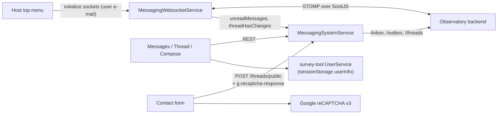

# Architecture

## Purpose and responsibilities

messaging-system-ui is the user interface of the Observatory messaging system:

- **Inbox and outbox** of the active group (stakeholder, coordinator or administrator) with search, sorting, paging
  (10 per page), read/unread state and bulk selection;
- **Threads**: view a thread, reply (optionally anonymously), mark messages read;
- **Compose**: start a thread addressed to groups or e-mail addresses, with a rich text body;
- **Live updates**: unread counters and "new message" notifications pushed over STOMP;
- **Public contact form**: visitors write to a group chosen from a list (country data, survey improvements, other),
  protected by reCAPTCHA v3.

**Out of scope.** Storage, delivery (including e-mail), authorisation and spam checks are done by the backend. The module
does not authenticate users and does not start the live sockets itself: the host does (see below).

## Structure

| Area | Location | Notes |
|---|---|---|
| Module and routes | `app/messaging-system.module.ts`, `messaging-system-routing.module.ts` | `MessagingSystemModule`: routes `contact`, `messages`, `messages/:threadId`; provides the reCAPTCHA site key and `MessagingWebsocketService` |
| Pages | `app/pages/{contact,messages,thread,emailCompose}` | `ContactComponent`, `MessagesComponent`, `ThreadComponent`, `EmailComposeComponent` |
| Domain | `app/domain/messaging.ts`, `paging.ts` | `Message`, `TopicThread`, `Correspondent`, `UnreadMessages`, `NewPaging` |
| REST service | `services/messaging-system.service.ts` | `MessagingSystemService` (root-provided): threads, inbox/outbox, messages, groups, unread count; keeps `unreadMessages` and the current thread as subjects |
| Socket service | `services/messaging-websocket.service.ts` | `MessagingWebsocketService`: two STOMP-over-SockJS connections (unread counter, notifications) with automatic reconnect |

Imports from the rest of the stack: `UserService`, `StakeholdersService`, `UserInfo` and `URLParameter` from survey-tool;
`RichTextEditorComponent` from catalogue-ui; `PageContentComponent` and `SidebarMobileToggleComponent` for layout.

## How the module is wired into the host

observatory-ui includes the module **twice**, which makes the routes reachable in two places:

1. `AppModule` imports `MessagingSystemModule` directly, so `contact`, `messages` and `messages/:threadId` exist at the
   root of the router. The public contact page is linked from the top menu as `/contact`.
2. `app-routing.module.ts` also lazy-loads it under `contributions/:id`, which is where the dashboard's "Messages" menu entry points
   (the `:id` is the active group id and becomes the `groupId` for inbox/outbox queries).

None of these routes has a route guard; the pages read the user from `UserService` and the backend refuses unauthorised requests.

The live sockets are started by the host's top menu once a user is known: it connects the unread socket to
`/topic/messages/inbox/unread/{email}`, joins `/app/messages/inbox/unread/{email}` and connects the notification socket to
`/topic/messages/inbox/notification/{email}`. Incoming messages update `MessagingSystemService.unreadMessages` and
`threadHasChanges`, which the pages observe.

## Persistence and client-side state

No browser persistence of its own. It reads `sessionStorage.userInfo` and `currentStakeholder`/`currentCoordinator`/
`currentAdministrator` (written by survey-tool's `UserService`) and updates the current group through `UserService`.

## Authentication and authorisation relationship

Requests use the host's session cookie. `getInbox`, `getOutbox` and `postMessage` additionally attach an
`Authorization: Bearer <AccessToken cookie>` header (see [security.md](security.md)). The group the user acts as is chosen in the
dashboard; the backend checks that the user belongs to the `groupId` it receives.

## Constraints and decisions

- **Not independently buildable:** it imports `environments/environment` from the host and several files from survey-tool
  (relative paths), and one file imports through the host's `src/` base path alias
  (`src/messaging-system-ui/services/messaging-system.service`), which needs `baseUrl: "./"` in the host's `tsconfig.json`.
- The 120-attempt/10-second reconnect policy is duplicated in the socket service and in catalogue-ui's services.
- The two sockets share one retry counter in `MessagingWebsocketService`.
- The notification text is rendered by UIkit's `notification()` with a fixed HTML string; the message content is not included.
