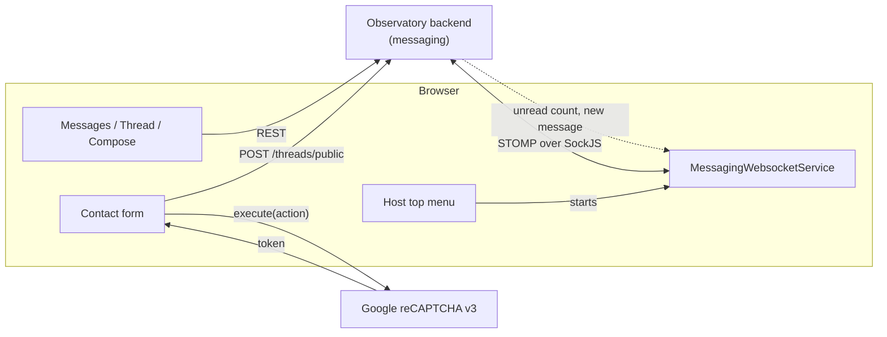

# Integration

messaging-system-ui talks to the Observatory messaging backend over REST and STOMP, to Google reCAPTCHA for the public
form, and is hosted by observatory-ui. Endpoint paths, parameters and schemas are owned by the backend's Swagger/OpenAPI
documentation; this document lists what the module depends on.

## Integrations

| Counterpart | Direction | Purpose | Protocol | Endpoint configuration | Authentication |
|---|---|---|---|---|---|
| Messaging REST API | Module → backend | Threads, inbox/outbox, messages, groups, unread count | REST/JSON | `MESSAGING_ENDPOINT` | Session cookie; XSRF header on writes; no `Authorization` header (see [security.md](security.md)) |
| Unread socket | Backend → module | Live unread counters | STOMP over SockJS | `WS_ENDPOINT` | Session cookie; `X-XSRF-TOKEN` in CONNECT headers |
| Notification socket | Backend → module | "You have a new message" notification and thread refresh | STOMP over SockJS | `WS_ENDPOINT` | Same |
| Google reCAPTCHA v3 | Module → Google | Token for the contact form | HTTPS (ng-recaptcha-2) | `RECAPTCHA_V3_KEY` | Public site key |
| survey-tool | Module → services | Current user, active group, stakeholder lookups | TypeScript imports | none | none |
| catalogue-ui | Module → component | Rich text editing | Angular component | none | none |

## REST endpoint groups used

| Group | Used for | Method in `MessagingSystemService` |
|---|---|---|
| `GET /threads`, `GET /threads/{id}?groupId=` | List threads, open a thread | `getThreads`, `getThread` |
| `GET /inbox/threads`, `GET /outbox/threads` (`groupId`, `email`, search/sort/paging parameters) | Inbox and outbox | `getInbox`, `getOutbox` |
| `GET /inbox/unread` | Initial unread counters | `setUnreadCount` |
| `POST /threads`, `POST /threads/{id}/messages?anonymous=` | New thread, reply | `postThread`, `postMessage` |
| `PATCH /threads/{id}/messages/{messageId}?read=` | Mark a message read or unread | `setMessageReadParam` |
| `POST /threads/public` + `g-recaptcha-response` header | Public contact form | `postThreadPublic` |
| `GET /groups` | Group list for the contact form and for compose recipients | `getGroupList` |

## Reconnect and failure behaviour

- **Sockets:** on a failed connect or a closed connection each socket reconnects automatically after one second, for roughly
  120 attempts, and then every 10 seconds. The attempt counter is shared by the two sockets and reset when either connects.
  While disconnected, unread counters and notifications are stale; the REST-based pages still work.
- **REST errors:** no retries and no client-side timeouts. Errors are handled by the calling component (typically logged with
  `console.error`); the host's HTTP interceptor handles `401` (clears the user) and `403` (notification and redirect to `/home`).
- **Contact form:** if the reCAPTCHA token cannot be obtained, the form is still posted without the header and the backend decides;
  a failed post shows the error message "Something went wrong, please try again later." above the Send button (the error is also
  logged to the console) and the form keeps its values.
- **Group list unavailable:** the contact form's group selector stays empty.

## Host contract

| What | Direction | Detail |
|---|---|---|
| `environment` (`MESSAGING_ENDPOINT`, `WS_ENDPOINT`, `RECAPTCHA_V3_KEY`) | Host → module | [configuration.md](configuration.md) |
| Socket initialisation | Host → module | Host calls `initializeWebSocketConnectionUnread`, `WsJoin`, `initializeWebSocketConnectionNotification` after login |
| Active group | Host/survey-tool → module | Route parameter `id` of `contributions/:id`, plus `UserService.currentStakeholder/Coordinator/Administrator` |
| Unread state | Module → host | `MessagingSystemService.unreadMessages` (a `BehaviorSubject`) is shown by the host's top menu |
